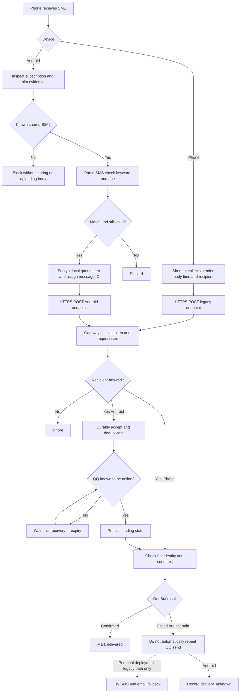
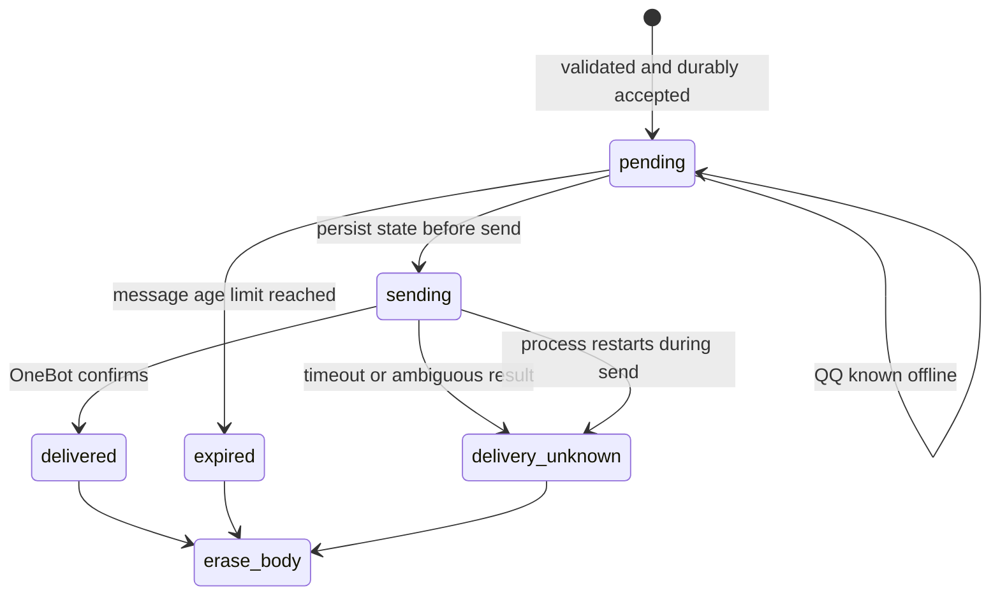
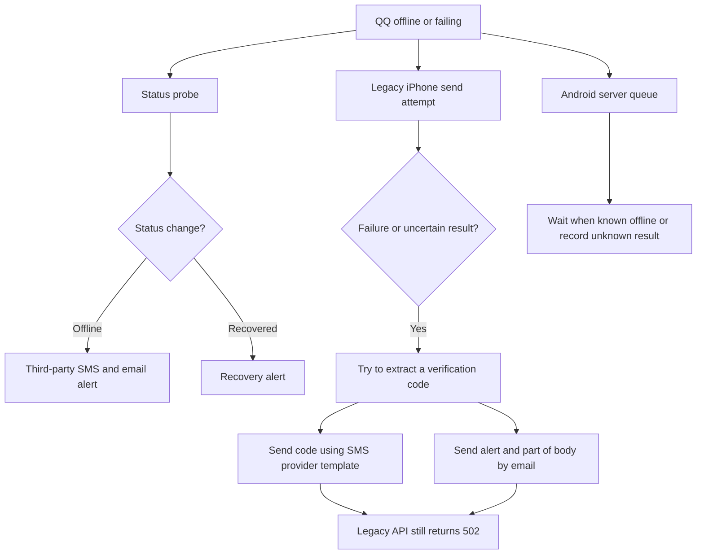

# SignalNest

**One SIM. Shared messages. Connected people.**

A lightweight, self-hosted SMS relay for sharing messages received by a designated SIM. A phone receives SMS, your server processes it, and selected messages can be forwarded to a configured QQ group.

*One SIM, several people, and a QQ bot with a delivery job.*

[中文](README.md) | [Chinese story](docs/story.zh-CN.md) | [English story](docs/story.en.md)

The project began when several students shared one campus SIM for network access, but verification texts arrived only on the phone holding the card. Each time a code arrived, someone had to find the phone and pass the message along. Eventually I wondered whether the phone could deliver it to a place everyone already checked.

The first version sounded straightforward: send some JSON to a server and have a bot post it to a QQ group. The interesting work turned out to be around that request. Which SIM actually received the text? What happens when QQ is offline? If a request times out, did the message fail—or did it arrive before the confirmation was lost?

This repository documents the route from an iPhone shortcut to an Android app:

```text
SMS on a phone → private gateway → QQ bot → shared group
                                    ↘ personal deployment: optional SMS/email fallback
```

> **The distinction matters:** this public repository includes the sanitized gateway and Android source. The SMS/email fallback was added later to the personal deployment and is **not included or enabled here**. Its design and limitations are described below.
>
> This is a personal project, not a fully audited messaging product. Forward messages only with the informed consent of everyone concerned. The original iPhone deployment used public HTTP; the HTTPS setup recommended here does not mean that original connection was encrypted.

## Use Cases

When more than one person needs to see messages sent to a designated number, SignalNest can relay eligible SMS from the receiving phone to a configured QQ group. Use a SIM that you or your organization are authorized to use, and obtain informed consent from everyone concerned.

### Campus Networks and Shared Wi-Fi

When students share a campus SIM for network access, verification texts arrive only on the phone holding it. With the relevant people's consent, eligible messages can be relayed to a shared QQ group, reducing manual forwarding. The same approach can be considered for shared Wi-Fi services that send SMS to that number.

### Shared Family Services

A family may use one number for broadband, property, utilities, or deliveries, leaving one person to pass along the resulting texts. Eligible SMS sent to that number can be forwarded to a family QQ group for the relevant members to read.

### Shared Business and Team Numbers

A studio, community group, or small business may receive order, appointment, and delivery notifications on a shared number. Authorized members can read eligible SMS in the configured QQ group instead of relying on one person to forward them. This is not an order management or customer service system.

### Device and Infrastructure Alerts

Maintenance staff can use a dedicated SIM to receive SMS alerts from industrial equipment, UPS units, network devices, or security systems, then relay them to an on-call QQ group. The device or monitoring system must itself be able to send SMS to that number. SignalNest does not collect telemetry or replace a dedicated monitoring platform.

### On-Call Teams and Project Coordination

Property, warehouse, maintenance, or on-call teams and temporary project groups can receive business notifications on a shared number and forward eligible texts to their QQ group. This can reduce manual handoffs between shifts; the project does not provide scheduling, ticketing, or alert escalation.

### Development Testing and QA

Developers and testers can use a dedicated SIM to receive test codes or status messages from their test system and share them in a QA or development QQ group. Use only accounts, devices, SIM cards, and environments that you own or are explicitly authorized to use; do not bypass third-party interactive verification or account security controls.

> **Public-version scope:** The server is configured with one target phone number and one QQ group. Android filters by its bound SIM and keywords; iPhone shortcut triggers determine which messages are submitted. Android's durable queue and deduplication do not apply to the legacy iPhone endpoint. These examples require configuration and do not imply multi-platform routing, advanced permissions, or direct device monitoring.

## Why a phone, a server and QQ?

The phone already received SMS, the Linux server was already running other services, and a QQ group gave the intended recipients a common place to read messages. NapCat runs the QQ bot and exposes a OneBot 11 interface. The gateway checks incoming requests and calls that interface locally.

An existing server is not an empty machine. Ports may already be occupied, and Nginx may already serve other sites. The gateway and OneBot therefore listen on loopback; the reverse proxy exposes only the required gateway routes. Inspect existing configuration before changing it.

The first client was an iPhone shortcut. Android brought a different challenge: the default data or voice SIM is not proof of which SIM received a text. The Android client checks subscription and slot evidence first. If the line is unknown, conflicting, or not the selected shared SIM, it blocks the message before saving or uploading its body.

## Following a message



The gateway checks the bot identity before sending, and uses a OneBot **text message segment** so content is not interpreted as a command. A mismatched recipient is ignored; an invalid token is rejected.

### Why Android has a queue

A timeout can mean the server never received the upload. It can also mean QQ already sent the group message but the acknowledgement never came back. Retrying the second case blindly can create duplicates.

Android assigns a stable message ID and encrypts the local queue item. Retries use the same ID. The server persists the message before acknowledging it: the same ID and payload returns the existing state, while reusing an ID for different content is rejected.



Messages expire ten minutes after their SMS timestamp. The server removes the body after delivery, expiry or an ambiguous result; deduplication state is retained for approximately seven days. `delivery_unknown` is not automatically replayed: check the group yourself. This trades possible missed delivery for fewer blind duplicates. The file inbox uses an in-process lock, so run **one worker and one gateway instance only**.

The legacy iPhone endpoint is synchronous and does not have Android's durable queue or deduplication. A 502 does not prove that a message was absent from the group.

## When QQ is unavailable

The personal deployment later explored two separate responses: monitoring QQ status and notifying people of changes, and attempting a third-party fallback when the legacy endpoint's QQ send fails.



The personal implementation used Spug Push Assistant. Its chosen SMS template only accepted a short code, so it could carry an extracted verification code rather than the whole message. Email could carry the sender, time and a truncated body. Pattern matching is fallible: it can select the wrong number or find none. A provider's success response does not prove the recipient's phone or inbox received it. The original implementation also logged extracted values; any operator must inspect and change such logging before use.

The legacy API still returns **502 after attempting fallback**. A caller retry can trigger another fallback, and a timed-out QQ call may already have posted to the group. Android does not use that fallback: it waits when QQ is known offline and stops automatic replay after an ambiguous send.

Monitoring and fallback are not the same as automatic login. The personal deployment had timers for monitoring and recovery; they were inactive at the last inspection. **None of these third-party or auto-login scripts is in this public repository.** If you build a fallback, handle private credentials, recipient consent, rate limits, cost, durable state and failure alerts; test against a mock first. Do not bypass interactive account verification using SMS codes.

## Set up the server

This is a minimal Linux setup for the public version. It does not install or log in to QQ for you. Bring your own QQ account and group, valid HTTPS hostname/certificate and NapCat installation.

### 1. Install and configure the gateway

```bash
git clone https://github.com/Xie-Fantasy/SignalNest-shared-sms.git
cd SignalNest-shared-sms
python3 -m venv .venv
. .venv/bin/activate
pip install -r requirements.txt
```

Replace every placeholder in a private environment. Generate a token of at least 64 characters with `python -c 'import secrets; print(secrets.token_hex(32))'`, save it privately, and generate a different OneBot token. Do not commit or share real values.

```bash
export SMS_PUSH_TOKEN='<random token of at least 64 characters>'
export TARGET_RECIPIENT='<11-digit mainland China shared mobile number>'
export QQ_FORWARD_ENABLED=true
export NAPCAT_API_URL='http://127.0.0.1:13000'
export NAPCAT_ACCESS_TOKEN='<separate OneBot token>'
export QQ_TARGET_TYPE=group
export QQ_TARGET_ID='<QQ group ID>'
export BOT_QQ_ID='<bot QQ ID>'
export ANDROID_INBOX_DIR='/var/lib/sms-gateway/android-inbox'
uvicorn app.main:app --host 127.0.0.1 --port 8000 --workers 1
```

Create the inbox directory with access restricted to the service account. For a persistent deployment, use an unprivileged service user and a process manager, with environment variables in a private configuration. `GET /health` only shows that the gateway responds; it does not prove QQ is online or that a group message arrived.

### 2. Set up the QQ bot

Install NapCat separately, log in through its WebUI and configure a OneBot 11 HTTP service with a separate token. Bind the host endpoint to `127.0.0.1:13000`, not the public internet. Use an SSH tunnel for remote administration. Verify the logged-in account and its membership in the target group before a test agreed to by the group. Handle login challenges manually; keep passwords, sessions, QR codes and tokens private.

### 3. Put HTTPS in front

This is an **example fragment**: substitute your own hostname and certificate paths. Back up and inspect your existing Nginx configuration first, run `nginx -t`, and reload only when appropriate. The certificate must match the requested hostname.

```nginx
server {
    listen 443 ssl;
    server_name sms.example.com;
    ssl_certificate     /path/to/fullchain.pem;
    ssl_certificate_key /path/to/private-key.pem;
    client_max_body_size 64k;
    access_log off;
    location = /health { proxy_pass http://127.0.0.1:8000; }
    location = /api/message/push { proxy_pass http://127.0.0.1:8000; }
    location /api/android/ { proxy_pass http://127.0.0.1:8000; }
    location / { return 404; }
}
```

Do not expose Uvicorn or OneBot directly or disable certificate verification. The business endpoints require `Authorization: Bearer <your token>`. The public Android app trusts system CAs. A self-signed deployment needs its own configured trust anchor and valid hostname verification.

## Set up the iPhone shortcut

1. Create a personal automation triggered by **Message Received**. Choose sender/content conditions appropriate for the shared SIM; available options vary by iOS version.
2. Add **Get Contents of URL**, set the URL to `https://your-host/api/message/push`, and select POST.
3. Add `Authorization: Bearer <your token>` and `Content-Type: application/json`. Bind actual shortcut variables to this JSON structure:

```json
{
  "sender": "sender variable",
  "recipient": "shared SIM phone number",
  "message": "message body variable",
  "receivedAt": "received time variable"
}
```

4. Check that the automation can run under your chosen conditions and the fields contain variables rather than just names. With the group's agreement, test using a harmless message you control. If the server sees nothing, first check the automation trigger and phone network.

`forwarded: true` means the QQ interface acknowledged the request. `forwarded: false` may indicate a recipient mismatch or disabled QQ forwarding. On an error or timeout, check the group before retrying. Keep tokens out of screenshots and shared commands.

## Build and configure Android

No APK is published here. Open `android/` in Android Studio and configure the SDK; minimum Android version is 8.0 (API 26). The Gradle Wrapper JAR is excluded: generate it using a trusted Gradle installation or configure Gradle in Android Studio. Release builds require your own private signing keys and local signing configuration. The public TLS configuration differs from the original deployment and needs validation in your environment. The app still displays the original dedicated-certificate wording; the public network security configuration actually trusts system CAs by default.

1. Install the app on the receiving phone. Under **Server**, enter your HTTPS endpoint and token, save them, and test the connection. That test does not send a group message.
2. Alternatively import a privately created `.smsrelay` JSON file: `{"endpoint":"https://sms.example.com","token":"<your token>"}`. It contains a credential; dispose of the phone's copy safely after import and never commit or share it.
3. Grant SMS reception and phone-state permissions. Under **SIM**, compare the displayed recipient suffix with the physical card and select the shared SIM.
4. On dual-SIM phones, test **both lines**: choose the test for each card and use another phone to send the displayed marker to that card. Both must pass. Test messages stay local. With one active SIM, still confirm it is the shared card.
5. Set keywords under **Rules**; the default matches the Chinese word for verification code. Any listed keyword can match. Enable forwarding on the home screen and test the complete route with a harmless message.
6. Allow background activity according to the device's settings. Recheck binding after SIM, slot, subscription or system changes. Battery restrictions, force-stop and missing SIM metadata can delay or prevent forwarding.

“Server accepted” means durably queued, not confirmed delivered to QQ; check **Diagnostics** for later state. Disabling forwarding or changing rules/server settings can clear queued bodies. Three-vendor real-device, dual-SIM, multipart and 24-hour tests remain outstanding for this public version.

## Troubleshooting

| Symptom | Check first |
| --- | --- |
| No server record | Shortcut trigger or Android enablement, network and HTTPS address |
| 401 / authorization expired | Whether phone and server tokens match; do not disclose them |
| Ignored, no group message | `TARGET_RECIPIENT` and the shared SIM number |
| Android cannot enable | Permissions, server connection, binding, tests on both SIMs and keywords |
| Accepted but absent from group | Pending/expiry state, QQ identity and group membership |
| `delivery_unknown` or legacy 502 | Check the group before considering a retry |
| QQ offline | NapCat and login status; complete required verification manually. Public code has no auto-recovery or fallback |

## Privacy and limits

Group members can read forwarded content. Obtain consent and use the narrowest useful keyword rules. Android's server queue holds plaintext while waiting to send, so protect server access, logs and backups; third-party services and email require their own protections. Both clients share a token and individual devices cannot currently be revoked independently. OS restrictions can delay or lose SMS; queue entries expire; a OneBot acknowledgement is not a read receipt.

This project is released under the [MIT license](LICENSE). NapCat, QQ, dependencies and other services have their own terms.
