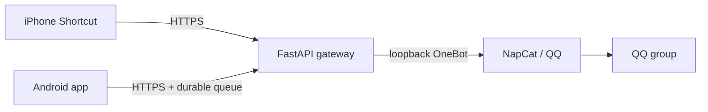

# Shared SMS: giving QQ a job as a messenger

[中文](README.md) · [Read the story](docs/story.en.md) · [中文故事](docs/story.zh-CN.md)

I wanted to see messages from one SIM on different devices without hunting down the phone that held it. The result is a small relay: an iPhone shortcut or Android app sends an SMS to a FastAPI gateway, which asks a NapCat OneBot endpoint to post it to a chosen QQ group.

This is a personal project and an account of the engineering decisions behind it, not a turnkey secure messaging service. Read the [full story](docs/story.en.md) for the trade-offs.



## What is here

- `app/`: authenticated API, text-only QQ forwarding and a durable Android inbox.
- `android/`: Kotlin client with SIM checks, encrypted local storage and background uploads.
- `docs/`: the project story in Chinese and English.

The public release is based on the local source. Later private operational scripts, QQ auto-login and a third-party fallback are excluded, as are credentials, certificates, signing keys and APKs.

## Server setup

Use Python 3.11+, your own QQ account and group, and a local NapCat OneBot 11 HTTP endpoint. Set secrets in a private environment:

```bash
python -m venv .venv
. .venv/bin/activate
pip install -r requirements.txt
export SMS_PUSH_TOKEN="$(python -c 'import secrets; print(secrets.token_hex(32))')"
export TARGET_RECIPIENT="<11-digit mainland China mobile number>"
export QQ_FORWARD_ENABLED=true
export NAPCAT_API_URL="http://127.0.0.1:13000"
export NAPCAT_ACCESS_TOKEN="<separate OneBot token>"
export QQ_TARGET_TYPE=group
export QQ_TARGET_ID="<group ID>"
export BOT_QQ_ID="<bot QQ ID>"
export ANDROID_INBOX_DIR="/var/lib/sms-gateway/android-inbox"
uvicorn app.main:app --host 127.0.0.1 --port 8000
```

Place a properly configured HTTPS reverse proxy in front of the gateway; do not expose Uvicorn or OneBot directly. Restrict the inbox directory to the service user. The file-backed inbox uses an in-process lock: run **one worker and one instance only**. Arrange your own backups, service user, access controls and monitoring.

`GET /health` is public. `POST /api/message/push` accepts `sender`, `recipient`, `message` and `receivedAt`. Android uses `/api/android/status`, `/api/android/message/push` and `/api/android/message/status`. These API routes require a Bearer token. Never put real messages or credentials in examples or issues.

## Android

Open `android/` in Android Studio and configure your HTTPS endpoint and pairing token. Grant the requested permissions, bind the shared SIM and test both directions on a dual-SIM device. Revalidate after SIM or system changes. The public version trusts system CAs only; self-signed deployments need their own trust anchor and hostname validation. Do not disable TLS verification. Configure your own release signing keys privately. The Gradle wrapper JAR is excluded; generate it with a trusted Gradle installation or configure Gradle through Android Studio.

## Limitations

The Android queue expires messages after ten minutes and avoids replaying a send with an ambiguous result; that can mean a message is missed. The iPhone path has no equivalent durable deduplication. SMS may contain sensitive data visible to group members and service providers. The original iPhone deployment used HTTP; the HTTPS diagram above is a deployment recommendation, not proof that the original was encrypted. Real-device, dual-SIM, vendor and 24-hour validation remain outstanding for this public version. A shared token cannot revoke individual devices.

See the [Chinese README](README.md) for additional detail. [MIT License](LICENSE); third-party software and services have their own terms.
