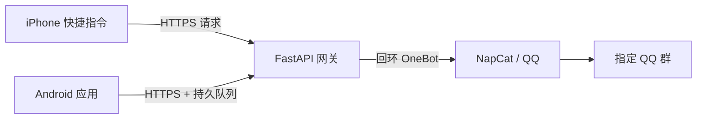

# 共享短信：我给 QQ 找了一份送信的工作

[English](README.en.md) · [完整故事](docs/story.zh-CN.md) · [The story](docs/story.en.md)

我只是想在不同设备上看同一张卡收到的短信，不必每次都去找插着卡的手机。最后，这条短信走过了手机、服务器和 QQ，才抵达群聊。

这个仓库记录了这次折腾的代码和思路：iPhone 快捷指令或 Android 应用接收短信，FastAPI 网关校验请求，再由 NapCat 的 OneBot 接口将消息发到指定 QQ 群。它是一个需要自行配置和验证的个人项目，不是开箱即用的安全短信服务。



## 一条短信为什么要绕这么远？

手机知道短信来了，却不一定能把它安全、可靠地交给另一台设备。服务器可以一直在线，但它既不知道短信属于哪张 SIM，也不能替 QQ 保证消息一定送达。于是项目里最重要的部分不是“发一条 HTTP 请求”，而是每一步失败时应该怎么办。

Android 先确认收信 SIM，再检查关键词。未知、冲突或非共享卡被拦截；通过规则的正文在本机加密入队。服务器给消息分配持久状态，发送结果不明时不自动重发，避免群里出现两份验证码。代价是：遇到超时或崩溃，可能需要人工查看群消息，不能承诺恰好一次送达。

iPhone 接口较简单：验证收件号码后同步调用 QQ；失败返回错误。它没有 Android 那套持久去重队列。完整的设计历程和取舍见[故事正文](docs/story.zh-CN.md)。

## 包含什么

- `app/`：FastAPI 接口、QQ 纯文本转发、Android 持久收件队列。
- `android/`：Kotlin Android 客户端源码，包含 SIM 检查、加密队列和后台上传。
- `docs/`：中英文项目故事。

本公开版基于本地源码整理。服务器后来加入的第三方备用通知、QQ 自动登录和运维脚本不在此仓库中；它们涉及个人配置，且未经过公开版改造。公开版不包含 APK、签名密钥、真实证书或配对文件。

## 运行服务端

需要 Python 3.11+、可用的 NapCat OneBot 11 HTTP 接口和自己控制的 QQ 账号及群。安装依赖后，在**私有环境**设置以下环境变量：

```bash
python -m venv .venv
. .venv/bin/activate
pip install -r requirements.txt
export SMS_PUSH_TOKEN="$(python -c 'import secrets; print(secrets.token_hex(32))')"
export TARGET_RECIPIENT="<11位共享手机号>"
export QQ_FORWARD_ENABLED=true
export NAPCAT_API_URL="http://127.0.0.1:13000"
export NAPCAT_ACCESS_TOKEN="<独立的OneBot令牌>"
export QQ_TARGET_TYPE=group
export QQ_TARGET_ID="<群号>"
export BOT_QQ_ID="<机器人QQ号>"
export ANDROID_INBOX_DIR="/var/lib/sms-gateway/android-inbox"
uvicorn app.main:app --host 127.0.0.1 --port 8000
```

不要直接暴露 Uvicorn 或 OneBot；使用自己配置的 HTTPS 反向代理，只开放所需路径。队列目录应仅允许服务用户访问。服务端使用进程内锁，**只能运行一个 worker 和一个实例**。生产部署还需自行处理服务账户、持久化、备份、访问控制和监控。

`GET /health` 是健康检查。旧接口为 `POST /api/message/push`，JSON 包含 `sender`、`recipient`、`message`、`receivedAt`；Android 使用 `/api/android/status`、`/api/android/message/push` 和 `/api/android/message/status`。除健康检查外，这些接口需要 `Authorization: Bearer <token>`。不要把真实短信、Token 或账户信息放进示例、日志或 issue。

## Android 配置

使用 Android Studio 打开 `android/`。配置有效的 HTTPS 服务器地址与自己的配对 Token；应用内按提示授权、绑定共享 SIM。双卡需对两条线路分别进行正反探测。系统升级、换卡或订阅信息改变时重新验证。

公开版移除了原服务器证书和 IP，只信任系统 CA；如使用自签证书，需自行配置专用信任锚及正确的主机名校验。不得关闭 TLS 校验或回退到明文 HTTP。Release 签名需自行配置 `signing.local.properties` 与密钥；不要提交这些文件。Gradle Wrapper 的 JAR 未包含，请使用可信 Gradle 生成或通过 Android Studio 配置。

## 边界与安全

短信可能包含验证码和个人信息。只转发已获授权的短信；QQ 群成员和第三方服务可能看到内容。iPhone 的原始部署曾使用明文 HTTP，此公开版示意图和部署建议要求 HTTPS，**不代表原部署已经加密**。验证证书、手机后台限制和实际快捷指令触发条件都需自行测试。Android 真机、双卡、不同厂商和 24 小时稳定性尚无本公开版验收结果。共享 Token 也不提供独立设备撤销。

请勿将真实凭据、号码、消息或服务端日志提交到仓库。发现安全问题时请私下联系维护者，不要公开敏感内容。

## 许可

[MIT License](LICENSE)。第三方依赖和 NapCat/QQ 的使用需遵守各自条款。
