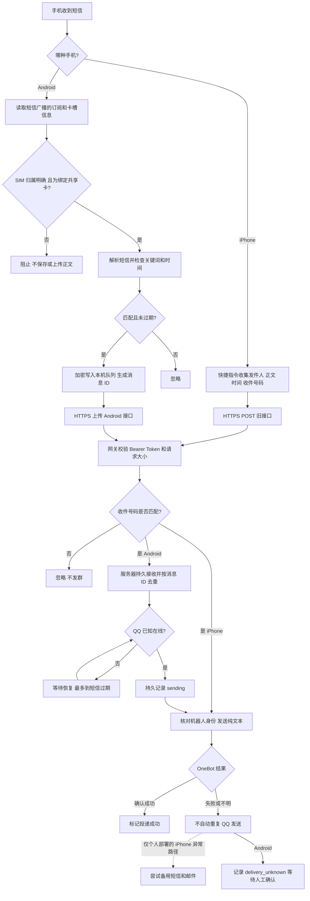
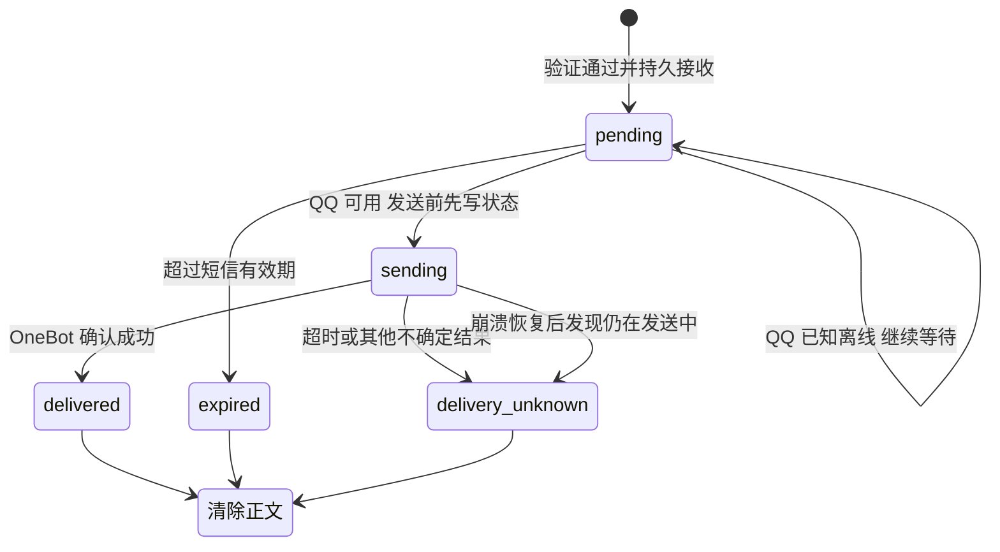
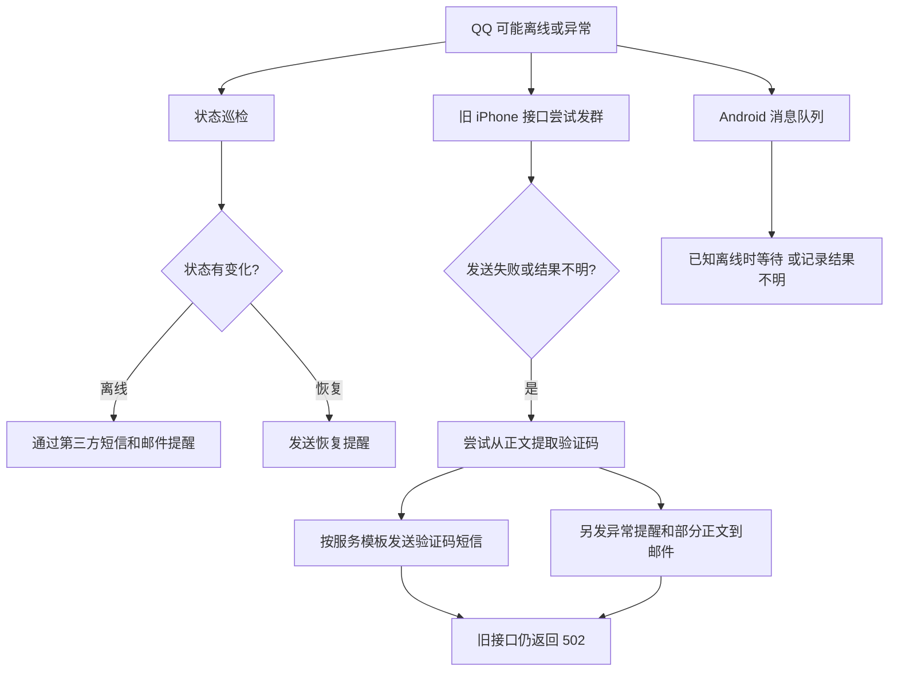

# 一张 SIM 卡，几个人看短信：我把 QQ 拉来送信

[English](README.en.md) ｜ [单独阅读中文版故事](docs/story.zh-CN.md) ｜ [English story](docs/story.en.md)

有一张大家都要用的卡，短信却只会落在插着它的那部手机上。每次等验证码，都要先找手机，再把消息转给需要的人。次数多了，我就想：能不能让它收到短信后，自己把消息送到大家都看得到的地方？

我的第一反应是做个转发。后来才发现，转发本身只需要几行代码，麻烦的是它周围那些问题：双卡手机怎么知道短信来自哪张卡？QQ 掉线了怎么办？请求超时后，到底是没发出去，还是已经发了、只是没收到回执？

这个仓库是我把这件事从 iPhone 快捷指令做到 Android 应用的记录。先看路线：

```text
收到短信的手机 → 我的服务器 → QQ 机器人 → 共享群
                                  ↘ QQ 出问题时，个人部署尝试备用短信 / 邮件
```

> **先说清楚版本差别：**本仓库公开了脱敏后的 iPhone 网关和 Android 源码。上图中的备用短信／邮件是个人部署后来加的方案，涉及第三方账户和私人配置，**没有包含在公开代码中，克隆仓库不会自动启用**。下文会把设计和限制讲清楚。
>
> 这不是一个已经完成全面安全审计的产品。短信可能包含验证码和个人信息，请只在相关人员知情同意的范围内使用。原 iPhone 部署曾使用公网 HTTP；本文推荐的 HTTPS 方案是部署要求，不能倒推为原来的链路已经加密。

## 目录

- [为什么选手机 + 服务器 + QQ](#为什么选手机--服务器--qq)
- [一条短信的完整旅程](#一条短信的完整旅程)
- [QQ 不能用时怎么办](#qq-不能用时怎么办)
- [从零搭建服务端](#从零搭建服务端)
- [让 iPhone 发出第一条请求](#让-iphone-发出第一条请求)
- [Android 安装与双卡配置](#android-安装与双卡配置)
- [出问题时从哪查](#出问题时从哪查)
- [已知限制和隐私](#已知限制和隐私)

## 为什么选手机 + 服务器 + QQ

我手里已经有能收短信的手机，也有一台运行其他服务的 Linux 服务器。手机负责接收，服务器负责校验和转发，QQ群负责让几个人在同一个地方看到消息。NapCat 提供 QQ 的运行环境和 OneBot 11 接口，网关通过本机接口让机器人发群消息。

刚开始我想得很简单：手机 POST 一段 JSON，服务器收到之后调用一次 QQ 接口。但服务器不是一张白纸：端口可能被别的程序占着，Nginx 也可能已经给其他网站转发。最后采取的做法是让短信服务只监听 `127.0.0.1`，由 Nginx 精确转发短信相关路径；OneBot 也只在回环地址提供给服务器本机使用。安装前先检查现有端口和配置，比一上来覆盖配置文件省事得多。

第一版跑通的是 iPhone 快捷指令。之后我希望换成 Android 手机，新的问题马上就来了：双卡手机收到的广播不一定能可靠说明短信进了哪个卡槽。把“默认上网卡”当成收信卡，看似省事，实际可能把私人卡短信转出去。Android 版因此先确认线路，再看正文，确认不了就不转发。

## 一条短信的完整旅程

### 两条入口，共用一个出口



服务端发群时先确认登录的是指定机器人，再以 OneBot 的**纯文本消息段**提交，避免短信里的特殊字符被当作消息指令。收件号码不匹配时，接口会忽略消息；Token 不对时直接拒绝。

### Android 为什么多了一层队列

手机请求超时，并不能说明服务器没收到；QQ 调用超时，也不能说明群里没收到。后者尤其麻烦：再发一次可能重复，不发又可能漏掉。

Android 先给每条消息生成稳定 ID，在本机加密入队；上传重试沿用这个 ID。服务器先写入磁盘，再确认接收。同一 ID 和同一内容会返回已有状态，同一 ID 换了内容则拒绝。



消息在接收后最多等到短信时间过去 **10 分钟**；终态会删除服务端队列中的正文，去重摘要和状态按实现保留约 **7 天**。`delivery_unknown` 不自动重发，需要人去群里确认。这个选择偏向避免重复，而不是保证每条都送达。服务端去重依赖进程内锁，所以当前只能跑**一个 Uvicorn worker、一个网关实例**。

旧 iPhone 接口是同步转发，没有 Android 这套持久队列和去重机制。看见 502 时尤其不要简单认定“群里一定没收到”。

## QQ 不能用时怎么办

QQ 机器人会掉线，接口也可能超时。个人部署后来加了两种补救思路：一是定时检查状态并发告警；二是在旧接口实际转发失败时，尝试走第三方推送服务。它们解决的是不同问题：



实际使用的备用服务是 Spug 推送助手。因为当时使用的短信模板只允许有限长度的验证码字段，备用短信只能承载提取出的代码；邮件通知可携带发件人、时间和截断后的部分正文。提取使用规则匹配，并不理解短信：可能取错数字，也可能提取失败。第三方接口返回成功也不等于手机或邮箱最终收到。原有实现还会记录提取结果，部署者必须自行检查并避免把验证码写入日志。

另一个容易忽略的细节：**备用通知之后旧接口仍返回 502**。调用方如果自行重试，可能重复触发备用通知；QQ 的超时也可能发生在群消息已经发出之后。Android 队列则没有接入同样的备用发送：已知离线时等待，开始发送后结果不明则停止自动重发。

状态巡检与备用发送也不等于自动登录。个人部署曾使用定时器监测和自动恢复，但上次检查时相关定时器并未运行，不能把它写成持续有效的保障。公开仓库不包含第三方推送或自动登录实现；如果你自行接入，应单独处理凭据保管、收件人同意、限频、费用、状态持久化与失败告警，先用模拟接口测试。不要用短信验证码绕过账号的人工验证。

## 从零搭建服务端

下面是公开版的最小运行路径，不会自动安装或登录 QQ。示例面向 Linux；请先确保你有自己的合法域名或其他可验证的 HTTPS 地址、证书、QQ 账号及目标群。

### 1. 准备 Python 服务

```bash
git clone https://github.com/Xie-Fantasy/shared-sms.git
cd shared-sms
python3 -m venv .venv
. .venv/bin/activate
pip install -r requirements.txt
```

在受保护的环境中设置配置，例子里的占位符都要换成自己的值；不要提交到仓库，也不要把含真实值的命令或日志分享出去。`SMS_PUSH_TOKEN` 至少 64 字符，可用 `python -c 'import secrets; print(secrets.token_hex(32))'` 生成后私下保存。OneBot Token 必须另外生成。

```bash
export SMS_PUSH_TOKEN='<至少64字符的随机令牌>'
export TARGET_RECIPIENT='<11位中国大陆共享手机号>'
export QQ_FORWARD_ENABLED=true
export NAPCAT_API_URL='http://127.0.0.1:13000'
export NAPCAT_ACCESS_TOKEN='<独立OneBot令牌>'
export QQ_TARGET_TYPE=group
export QQ_TARGET_ID='<目标QQ群号>'
export BOT_QQ_ID='<机器人QQ号>'
export ANDROID_INBOX_DIR='/var/lib/sms-gateway/android-inbox'
uvicorn app.main:app --host 127.0.0.1 --port 8000 --workers 1
```

先创建状态目录并确保只有运行服务的账户有权读写。正式运行时应使用独立的非 root 服务账户和进程管理器；环境变量需要放在仅该服务可读的私有配置里。检查 `/health` 只能证明网关进程响应，**不能证明 QQ 在线或群消息送达**。

### 2. 准备 QQ 机器人

自行部署 NapCat 并通过其 WebUI 完成登录，配置 OneBot 11 HTTP 服务和独立 Token。宿主机只将 OneBot 暴露到 `127.0.0.1:13000`；不要把管理页面或 OneBot 端口直接暴露公网。需要从本机管理远程 WebUI 时，可使用 SSH 隧道。确认登录账号就是配置中的机器人，且它已经加入目标群，再进行经过群成员同意的人工测试。

QQ 登录状态可能失效或要求额外验证，按平台提示人工处理。不要把密码、会话、OneBot Token 或二维码放进仓库。

### 3. 配置 HTTPS 反向代理

以下是**示意片段**，域名和证书路径仅为占位；请合并到你自己的 Nginx 配置，先备份、检查既有站点，执行 `nginx -t` 确认无误后再按环境安全地重载。证书必须与访问主机名匹配。

```nginx
server {
    listen 443 ssl;
    server_name sms.example.com;
    ssl_certificate     /path/to/fullchain.pem;
    ssl_certificate_key /path/to/private-key.pem;
    client_max_body_size 64k;
    access_log off;

    location = /health { proxy_pass http://127.0.0.1:8000; }
    location = /api/message/push { proxy_pass http://127.0.0.1:8000; }
    location /api/android/ { proxy_pass http://127.0.0.1:8000; }
    location / { return 404; }
}
```

不要直接暴露 Uvicorn 或 OneBot，也不要关闭证书验证。`GET /health` 无需 Token；两个客户端的业务接口都需要 `Authorization: Bearer <你的令牌>`。公开版 Android 默认信任系统 CA；如果使用自签证书，要自己在应用中配置专用信任锚，仍需验证主机名。

## 让 iPhone 发出第一条请求

1. 在「快捷指令」中创建**收到信息**的个人自动化。触发条件按自己的共享卡、发件人和信息内容选择；不同 iOS 版本的选项可能不同。
2. 在自动化中添加「获取 URL 内容」，地址填 `https://你的域名/api/message/push`，方法选 POST。
3. 添加请求头 `Authorization: Bearer <你的令牌>` 和 `Content-Type: application/json`。在 JSON 请求体里绑定真实的快捷指令变量：

```json
{
  "sender": "短信发件人变量",
  "recipient": "共享卡的接收号码",
  "message": "短信正文变量",
  "receivedAt": "接收时间变量"
}
```

4. 检查自动化是否允许在满足条件时运行，并确认变量确实绑定了内容，而不是只填了字段名。先用自己控制的、无敏感内容的短信，在群成员同意后测试；如果没有请求到达，先检查自动化触发条件和手机网络。

成功响应中的 `forwarded: true` 表示 QQ 接口确认；`forwarded: false` 可能是号码未匹配或 QQ 转发未启用。接口报错或超时不能证明群里没收到，检查群消息后再决定是否重试。不要把测试命令里的真实 Token 贴到聊天或截图中。

## Android 安装与双卡配置

公开仓库不提供 APK。用 Android Studio 打开 `android/`，配置 Android SDK；项目最低 Android 8.0（API 26）。仓库未包含 Gradle Wrapper JAR，需要使用可信 Gradle 生成或在 Android Studio 中配置。Release 构建还需要自己的签名密钥与本地签名配置；不要上传密钥。公开版与原部署使用不同的 TLS 信任配置，构建后要先在自己的环境验证。应用界面里仍有“专用证书”的原部署提示；公开版实际以网络安全配置为准，默认只信任系统 CA。

1. 将应用安装到接收共享短信的手机，打开「服务器」，手动填写 HTTPS 地址和 Token，保存并点击「测试连接」。此步骤不发群消息。
2. 也可以导入自己私下创建的 `.smsrelay` JSON 文件，格式为 `{"endpoint":"https://sms.example.com","token":"<你的令牌>"}`。它包含凭据，导入后妥善删除手机上的原文件，不要提交或分享。
3. 在首页授予「接收短信」和「电话状态」权限。进入「SIM」，核对服务器显示的号码尾号与实体卡，选择「仅共享此 SIM」。
4. 双卡手机需对**两张卡分别**点击「接收本卡测试短信」，用另一台手机向对应卡发送界面给出的标记。两条线路都通过后才能启用；探测短信仅用于本地验证，不上传。只有一张活动卡时也要人工确认它就是共享卡。
5. 在「规则」中设置关键词，默认是“验证码”，多个词按界面提示分隔，命中任一词即可。回到首页开启自动转发，再用无敏感内容的真实短信验证整条路径。
6. 按手机系统允许应用后台运行。换卡、换槽、系统升级或订阅变化后重新检查绑定；厂商省电、强行停止或系统不提供可靠 SIM 信息都可能导致延迟或无法转发。

「服务器已接收」只代表持久入队，不等于 QQ 已送达；在「诊断」查看后续状态。关闭转发、修改规则或服务器配置可能清除待上传正文。三厂商真机、双卡、长短信和 24 小时稳定性在此公开版仍待验证。

## 出问题时从哪查

| 现象 | 先检查什么 |
| --- | --- |
| 手机发了短信，服务器没有记录 | 手机自动化是否触发、Android 是否开启、网络与 HTTPS 地址是否正确 |
| 401 / 授权失效 | 手机与服务器的 Bearer Token 是否一致；不要在公开场合展示 Token |
| 返回忽略、没有发群 | `TARGET_RECIPIENT` 是否与共享卡号码一致，输入是否能规范化 |
| Android 无法开启 | 权限、服务器连接、共享卡绑定、双卡两条线路探测和关键词 |
| 服务器已接收但群里没有 | 查看 `pending` 是否仍在等 QQ、消息是否过期，检查机器人身份和群资格 |
| `delivery_unknown` 或旧接口 502 | 先看群里是否已收到；结果不明时不要盲目重试 |
| QQ 不在线 | 检查 NapCat 和登录状态，按要求人工验证；公开版不包含自动恢复和备用推送 |

## 已知限制和隐私

- 群成员能看到转发内容；先确认所有涉及人员同意，按需缩小关键词范围。
- 服务器在待发送期间会保存 Android 短信正文，应用和传输加密不能代替服务器访问控制。日志、备份、邮件和第三方平台也需要单独保护。
- Android 和 iPhone 共用一个服务端 Token，当前没有独立设备令牌的撤销机制。令牌泄露时需要整体更换并重新配对。
- Android 可能因为系统限制漏收或延迟；队列有时限；OneBot 的确认也不是阅读回执。
- 本项目代码以 [MIT](LICENSE) 许可开放。NapCat、QQ 和其他依赖或服务有各自的条款。

这个项目没有把“共享短信”变成一个完美的通用产品，但它至少让我弄明白了：短信从一台手机走到群里，中间每个“应该没问题”都值得单独问一句。
